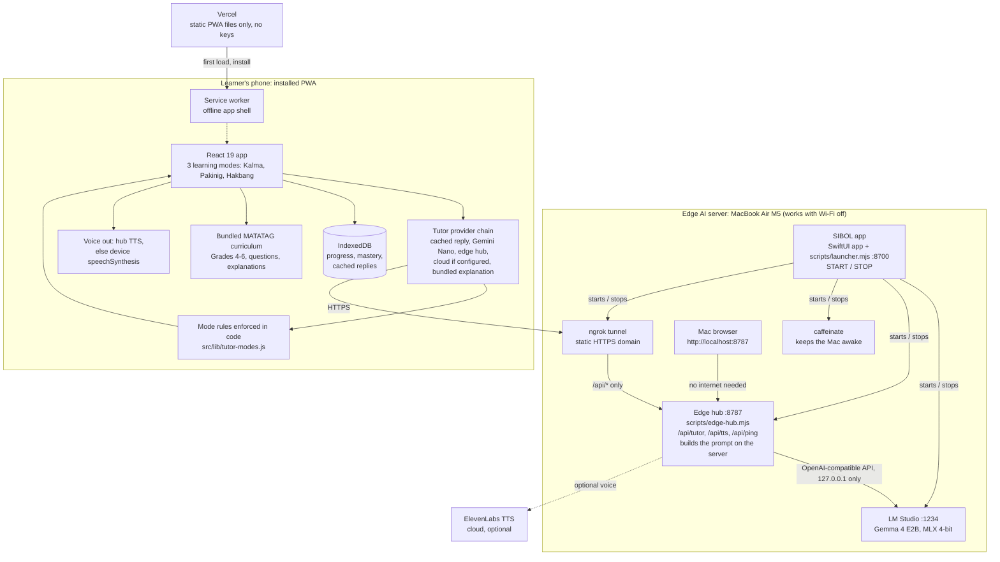

<p align="center">
  
</p>

<div align="center">

# SIBOL: Student-centered Inclusive Bilingual Offline Learning

[](https://sibol-tutor.vercel.app)
[](https://sibol-landing-ph.vercel.app)
[](https://www.youtube.com/watch?v=TskCOFxtuWo)
[](https://x.com/eirmonpaculan/status/2108728926076010535)
[](https://www.linkedin.com/posts/eirmonpaculan_appbuildersph-ugcPost-7514496661063221248-_qyx/)
[](docs/HACKATHON.md)

[-4285F4?logo=google&logoColor=white)](docs/SUBMISSION.md)
[](docs/EDGE_RUNBOOK.md)
[](docs/EDGE_RUNBOOK.md)
[](#why-edge--local-ai)

[](docs/ARCHITECTURE.md)


-informational)


[](docs/TUTOR_MODES.md)

</div>

An offline-first Local AI math companion for Filipino **Grade 4 to 6** learners (DepEd MATATAG curriculum). A friendly AI tutor answers a learner's question step by step in English, Tagalog or Taglish, and can read the answer aloud. The answers come from an open-source model, **Gemma 4 E2B, running on the team's own laptop** (an "edge" setup), not from a cloud AI API.

This repository was built for the AppBuildersPH Hackathon 2026 (theme: Local AI). Landing page: [sibol-landing-ph.vercel.app](https://sibol-landing-ph.vercel.app) (source: [`public/landing.html`](public/landing.html), also served by the app at `/landing.html`; it shows the three learning modes and who each is designed for, and its buttons open the live app). Demo video: [YouTube](https://www.youtube.com/watch?v=TskCOFxtuWo). Posts: [X](https://x.com/eirmonpaculan/status/2108728926076010535), [LinkedIn](https://www.linkedin.com/posts/eirmonpaculan_appbuildersph-ugcPost-7514496661063221248-_qyx/).

`#AppBuildersPH` `#LocalAI` `#EdgeAI` `#Gemma` `#DepEd` `#MATATAG` `#EdTech` `#Philippines`

## Team OHMAKINIGKA!

| Name | GitHub |
|---|---|
| Nyzel Cayat | [@chi4ki1](https://github.com/chi4ki1) |
| Paul Dacalan | [@polsalarm](https://github.com/polsalarm) |
| Lord Xander Dacillo | [@TadeyRuk](https://github.com/TadeyRuk) |
| Eirmon John Paculan | [@riecodes](https://github.com/riecodes) |

## For judges: set up SIBOL step by step

About 15 minutes, most of it the one-time model download. You need internet only for the setup. After that, SIBOL runs with Wi-Fi off.

**What you need:** a Mac with Apple Silicon (M1 or newer), about 6 GB of free disk space, and Google Chrome.

**Step 1. Install LM Studio.** Download it from [lmstudio.ai](https://lmstudio.ai), install it, and **open it once**. Opening it installs the `lms` command the setup uses. You can close it again.

**Step 2. Install Node.js 24.** Download the macOS installer from [nodejs.org](https://nodejs.org) and run it.

**Step 3. Download SIBOL.** Open the Terminal app and run:

```bash
git clone https://github.com/appbuildersph/sibol.git
cd sibol
```

**Step 4. Run the setup.** In the same Terminal window:

```bash
sh scripts/setup.sh
```

It checks your Mac, installs and builds the app, downloads Gemma 4 E2B in LM Studio (about 4.4 GB), and installs the **SIBOL** app in your Applications folder. When it finishes, SIBOL opens by itself. Later you can open it like any app: press Cmd+Space and type **SIBOL**. If a step fails, the script says what to install and stops; fix that and run it again (finished steps are skipped).

**Step 5. Start the AI.** In the SIBOL app, press **START**. Wait until the button turns green and says **READY**. That means Gemma has answered a test question on your Mac.

**Step 6. Open SIBOL.** In Chrome, go to **http://localhost:8787**.
1. Go through the short welcome steps. Step 3 asks how Teacher Gabo should help: pick **Calm**, **Listen** or **Step by Step**, or Standard.
2. Open a lesson.
3. Tap **Ask Teacher**, type a math question (for example "How do I know if an angle is acute?") and tap **Ask**.
4. The answer is labelled **Teacher Gabo AI server**. That label means Gemma on your Mac wrote it.

**Step 7. Try it offline.** Turn off Wi-Fi and ask another question. Gemma still answers, because everything runs on your Mac.

**Step 8. Stop.** Press **STOP** in the launcher when you are done. It stops Gemma, the hub and the keep-awake.

**Optional: SIBOL on a phone.** On an iPhone, open [sibol-tutor.vercel.app](https://sibol-tutor.vercel.app) in Safari, tap **Share**, then **Add to Home Screen**. Lessons and practice work offline on the phone. AI answers on the phone come from the team's own Mac through its tunnel, so they work only while the team's server is running; otherwise the phone shows the bundled explanations.

**If something goes wrong**

| Problem | Fix |
|---|---|
| The setup says LM Studio was not found | Open LM Studio once, then run `sh scripts/setup.sh` again |
| The launcher shows "Tunnel for phones" as failed | Expected on your Mac: the tunnel uses the team's account. Everything on your Mac still works |
| The answer is not labelled "AI server" | The launcher is not READY yet. Press START and wait for green, then ask again |
| You prefer not to use the launcher | Follow [Quick start A](#a-run-it-on-one-machine-no-accounts-needed) to start LM Studio and the hub by hand |

## The problem

Many Filipino Grade 4 to 6 learners study in homes and classrooms with weak or no internet. A cloud-only AI tutor fails exactly when they need it, charges for every question, and sends a child's questions to a third-party server. SIBOL keeps teaching with the network off, and its AI tutor runs on a machine the class controls.

## Why does this product benefit from running AI locally?

> Our learners are Filipino Grade 4-6 children, many in homes and classrooms with weak or no internet. A cloud-only tutor fails exactly when they need it, charges per question, and sends a child's questions to a third-party server. So the tutor's language model, Gemma 4 E2B, runs on a machine the class controls: a laptop acting as an edge AI server, through LM Studio, with no cloud AI API in the answer path. On that laptop the app and the tutor work with the network switched off. Phones on the same hub get the same tutor; if they cannot reach it, the app still teaches from bundled explanations. Local inference also means no per-question cost and replies in about a second (measured median 0.6-1.2 s for the learning modes on an Apple M5 MacBook Air). Cloud services are optional extras only, not the tutor's brain.

The evidence is below: [Proof of local inference](#proof-of-local-inference), [Offline proof](#offline-proof-the-mac-with-wi-fi-off) and [Measured so far](#measured-so-far).

## App showcase

Screens from the app at phone width (390 px, Chrome). The same practice question is shown in each learning mode so the differences are easy to compare. These were captured before two renames: the tutor was then called "Teacher Gabay" (now Teacher Gabo), and the English mode labels were Kalma, Pakinig and Hakbang (now Calm, Listen and Step by Step; Tagalog and Taglish still use Kalma, Pakinig and Hakbang).

**Meet Gabo, the tutor mascot.** Gabo changes pose with the learning mode (`src/ui/Mascot.jsx`).

<table>
  <tr>
    <td align="center" valign="top" width="25%"><br><sub><b>Standard</b></sub></td>
    <td align="center" valign="top" width="25%"><br><sub><b>Kalma</b></sub></td>
    <td align="center" valign="top" width="25%"><br><sub><b>Pakinig</b></sub></td>
    <td align="center" valign="top" width="25%"><br><sub><b>Hakbang</b></sub></td>
  </tr>
</table>

**Choosing a learning mode**

<table>
  <tr>
    <td align="center" valign="top" width="33%"><br><sub><b>Onboarding.</b> The learner (or an adult) picks a mode in step 3.</sub></td>
    <td align="center" valign="top" width="33%"><br><sub><b>Profile.</b> Grade, language and mode can be changed any time.</sub></td>
    <td align="center" valign="top" width="33%"><br><sub><b>Mode switch.</b> A short cover screen while the new mode is applied.</sub></td>
  </tr>
</table>

**One question, four modes**

<table>
  <tr>
    <td align="center" valign="top" width="25%"><br><sub><b>Standard.</b> Doodles, "Quick Challenge" label, animated mascot.</sub></td>
    <td align="center" valign="top" width="25%"><br><sub><b>Kalma.</b> Plain background, no decorations, a "Question 1 of 5" counter.</sub></td>
    <td align="center" valign="top" width="25%"><br><sub><b>Pakinig.</b> Large text, the spoken word highlighted, read-again and speed controls.</sub></td>
    <td align="center" valign="top" width="25%"><br><sub><b>Hakbang.</b> The step-by-step mode; questions with steps show a large step card.</sub></td>
  </tr>
</table>

**Tutor and offline**

<table>
  <tr>
    <td align="center" valign="top" width="50%"><br><sub><b>Ask the tutor.</b> Typed or spoken question; the reply comes from Gemma 4 E2B on the edge AI server and can be read aloud.</sub></td>
    <td align="center" valign="top" width="50%"><br><sub><b>Offline.</b> A banner shows for 5 seconds when the connection drops; lessons keep working.</sub></td>
  </tr>
</table>

## Why edge / local AI

- **No cloud AI API in the tutor path.** With the edge backend on, a question is answered by Gemma 4 E2B served by LM Studio on a machine the team controls.
- **No per-question cost.** Inference uses the laptop's own hardware.
- **Works with the laptop offline.** On the laptop itself, open the app at `http://localhost:8787`: the model and the app both run with the network off.
- **Child data stays on the team's machine for tutor questions.** There are no accounts, and the learner's progress is stored on their own device (IndexedDB).

What is *not* local, stated plainly:

- **Phones need a connection to reach the laptop.** The demo uses an ngrok tunnel, so a phone needs internet to talk to the laptop. Without it the app falls back to bundled explanations.
- **Optional ElevenLabs voice sends text to ElevenLabs.** If you enable `TTS_PROVIDER=elevenlabs`, the tutor's *reply text* is sent to ElevenLabs to generate speech. Without it, the app uses the device's own speech synthesis.
- **Optional cloud fallbacks.** If the edge hub is unreachable and a host has cloud credentials configured, the app can fall back to its older Gemini endpoints (`/api/tutor`, `/api/questions`, `/api/transcribe`, Google text-to-speech). They are off unless credentials are set.
- **One laptop serves many phones**, so replies slow down under load.

## Learning modes

Three modes change both the interface and how the tutor replies. They are designed to support learners with different needs. The app does not diagnose anyone, makes no clinical or efficacy claims, and any learner can choose any mode. Definitions: [`docs/TUTOR_MODES.md`](docs/TUTOR_MODES.md).

| Mode | Designed to support | Tutor behaviour |
|---|---|---|
| **Kalma** (English label: Calm) | learners who benefit from a calm, predictable screen | two short sentences, one idea, calm tone |
| **Pakinig** (English label: Listen) | learners who benefit from listening | written for speech: no symbols or markdown, "3/4" spoken as "three fourths" |
| **Hakbang** (English label: Step by Step) | learners who benefit from small steps | one step per reply, simple words, then a check question |

Small models follow format instructions unreliably, so the mode rules are also enforced **in code after the model replies** (`src/lib/tutor-modes.js`); a reply that fails validation falls through to the next provider.

In English the app shows the modes as Calm, Listen and Step by Step; in Tagalog and Taglish it keeps Kalma, Pakinig and Hakbang.

**Status:** implemented and tested: the mode preference (onboarding step with an animated preview of each mode, and the Profile screen), the mode-aware tutor prompt, the post-processing rules, per-mode screens (a calmer Kalma screen, large type with read-aloud word highlighting in Pakinig, a step card in Hakbang) and per-mode voice settings. Gabo also changes pose with the mode. Not built: the Grade 1 to 3 unlock for Hakbang. The modes are a design for different learners, not a tested intervention.

## What you may not see (and why)

Some features are hidden, locked or replaced on purpose, depending on the learning mode, the connection or the learner's progress. If something seems to be missing in a demo, check this list first.

**By learning mode** (flags in `src/lib/mode-ui.js`, styles in `src/styles/modes.css`)

| Feature | Hidden or changed in | What happens instead |
|---|---|---|
| **3D classroom** button on the lesson intro | Kalma | Only the 2D classroom is offered. The 3D classroom is still in the app and still available in every other mode. |
| Background music and the sound toggle | Kalma | No music, and the toggle is hidden |
| Sound effects, the "correct" celebration overlay, the shake on a wrong answer | Kalma | Plain, quiet feedback |
| Background doodles, panel decorations, mascot sparkle and animation | Kalma | Plain background. Pakinig also drops the classroom panel decorations so text is easier to read. |
| "Quick challenge" label | Kalma | Replaced by a question counter ("Question 2 of 5") |
| Practice question read aloud with word highlighting, slower voice | Pakinig only | Every mode reads Teacher Gabo's lines aloud, but only Pakinig also reads the question with highlighting |
| Large step-by-step card | Hakbang only | Other modes show the normal-size steps |
| Grade 1 to 3 content | Everywhere (not built yet) | Planned for Hakbang only; the app teaches Grades 4 to 6 |

**By connection**

| Feature | When offline | What happens instead |
|---|---|---|
| Mic button (voice questions) | Shown but disabled ("needs internet"). Hidden completely if the browser supports neither speech recognition nor audio recording. Online, the mic uses the browser's own speech recognition first; recording for Gemini transcription is only used where that is missing. If nothing was heard, Gabo says "I didn't catch that". | The learner types the question |
| ElevenLabs voice | Not reachable | The device's built-in voice (`speechSynthesis`) reads aloud |
| AI tutor and AI questions | The edge hub cannot be reached | Bundled explanations and the bundled question rotation |
| Offline banner | Pops up for 5 seconds when the connection drops | None needed online |

**By progress or device**

| Feature | Condition | What happens instead |
|---|---|---|
| 2D and 3D classroom buttons | Locked until the learner has gone through both lesson intro steps | A lock icon shows on the buttons |
| Classroom tabs (explanation, example, practice) | Each opens only after the one before it is finished | A lock icon and a "locked" hint |
| 3D classroom | The device cannot draw 3D (WebGL fails) | A "3D class is not available" message with a button to continue the same questions in 2D |
| Practice list | Only lessons already answered with mastery below 80% | A "nothing to practise" message |
| Step-by-step card for a question | Only questions that have steps | The question is shown on its own |
| Achievements | Locked until earned | Shown with a lock |

## The SIBOL app: starting the model with one button

We built a small native macOS app, **SIBOL** (find it with Spotlight: Cmd+Space, type SIBOL), so anyone on the team can bring the edge AI server up or down without a terminal. **START** runs every step in order and skips what is already running: start the LM Studio server, load Gemma 4 E2B, start the edge hub, keep the Mac awake, open the tunnel for phones. Then it asks Gemma a test question. The button turns green (**READY**) only after Gemma has really answered. **STOP** shuts everything down after a confirmation.

<p align="center">
  
</p>

*Captured 2026-10-10 on the edge server with the stack running. The "Tunnel for phones" card pings the hub through the public tunnel every 10 seconds, so ACTIVE means a phone can really reach it.*

- **Download it (easiest):** `sh scripts/setup.sh` installs it for you (see [For judges](#for-judges-set-up-sibol-step-by-step)). By hand: get `SIBOL-macOS.zip` from the [latest release](https://github.com/appbuildersph/sibol/releases/latest), unzip it, and drag `SIBOL.app` into Applications. It needs an Apple Silicon Mac, Node.js, LM Studio with Gemma 4 E2B downloaded, and a clone of this repo with `npm install` done (Quick start A, first block). The app finds the clone in your home folder, Desktop, Downloads, Documents or next to the app; otherwise it asks you to pick the folder once.
- **First open:** the app is not notarized by Apple, so macOS blocks a double-click the first time. Right-click the app, choose **Open**, then **Open** again. Or run `xattr -dr com.apple.quarantine /Applications/SIBOL.app` once. (Not needed when `setup.sh` installed it.)
- **Or build it yourself:** `scripts/make-launcher-app.sh` (needs `swiftc` from the Xcode command line tools) creates `SIBOL.app` in `/Applications` with the SIBOL icon.
- **Phones need the team's tunnel.** The tunnel step uses the team's ngrok domain, so on another Mac it reports the tunnel as not running. Everything else still works, and the app is ready at `http://localhost:8787`.
- **How it works:** the window is SwiftUI (`native/edge-launcher/EdgeLauncher.swift`). Behind it runs `scripts/launcher.mjs` on `127.0.0.1:8700`, which does the actual steps. The same buttons are available in a browser at that address, without the native app.
- **Every part of SIBOL:** below the buttons, one health card per part of the system: Gemma in memory, RAM (sampled every 3 s, with peaks and a 10-minute chart), tutor traffic, voice and the ElevenLabs quota, the built app and offline cache, bundled content, the deployed PWAs and the tunnel, the Mac, and the code. **CHECK EVERYTHING** asks Gemma once per mode and language, plays one voice line per mode and runs `npm test`.

<p align="center">
  
</p>

- **Tested:** with the stack already running (every step reported "already running" and Gemma answered in about 1 s). A cold start from nothing has not been run yet. Details: [`docs/EDGE_RUNBOOK.md`](docs/EDGE_RUNBOOK.md).

## Architecture



The same app also runs on the Mac itself at `http://localhost:8787`, where the hub serves the built files and every request stays on the machine.

- **The hub only exposes** `/api/tutor`, `/api/ping` and `/api/tts` through the tunnel. LM Studio is never exposed, because a public tunnel to its raw API would be an open model proxy. The app files are served only to `localhost`, unless the hub is started with `EDGE_SERVE_APP=1` (then a tunnel URL can serve the app and the API from one address, which is how the phone test below was run).
- **The server builds the prompt** from the request's `ref`, `lang` and `mode` against the bundled curriculum. It never accepts a client-supplied system prompt. Origin allow-listing, size caps and per-IP rate limits come from `api/_shared.js`.
- **Tutor provider order** (`src/lib/tutor.js`): Chrome's built-in Gemini Nano if present, then the edge hub, then the cloud endpoint if configured, then a bundled explanation. Replies are cached in IndexedDB for offline re-reading.
- **Voice-out** (`src/lib/speech.js`): `/api/tts` on the edge hub when the app has one (ElevenLabs if configured), else the host's own endpoint, else the device's `speechSynthesis`.
- **Voice-in:** the browser's own speech recognition (Web Speech) first, started inside the learner's tap so iOS allows it; recording for Gemini transcription only where Web Speech is missing; otherwise the learner types.

More detail: [`docs/ARCHITECTURE.md`](docs/ARCHITECTURE.md), decisions in [`docs/DECISIONS.md`](docs/DECISIONS.md) (D-016 to D-018).

## Quick start

### A. Run it on one machine (no accounts needed)

This is the path for judges. It needs Node, LM Studio and the model.

```bash
git clone https://github.com/appbuildersph/sibol.git && cd sibol
npm install
npm test                 # Node test runner, no network or model needed
npm run build            # the hub serves the built app from dist/
```

1. Install [LM Studio](https://lmstudio.ai) and download **`google/gemma-4-e2b`** (MLX 4-bit, about 4.4 GB).
2. Start its server on the default port and make sure the model is loaded:
   ```bash
   ~/.lmstudio/bin/lms server start --port 1234
   ~/.lmstudio/bin/lms load google/gemma-4-e2b
   ~/.lmstudio/bin/lms ps          # google/gemma-4-e2b must be listed
   ```
3. Start the hub (no `.env` file is required for this path):
   ```bash
   node scripts/edge-hub.mjs
   ```
4. Open **http://localhost:8787**, choose a lesson and ask the tutor a question. The reply is labelled as coming from the AI server. Turn the network off to confirm it still answers.

Check the hub from a terminal:

```bash
curl -s -o /dev/null -w "%{http_code}\n" http://127.0.0.1:8787/api/ping     # 204
curl -s http://127.0.0.1:8787/api/tutor -X POST -H 'Content-Type: application/json' \
  -d '{"question":"Paano ko idadagdag ang 3/4 at 1/2?","ref":"4NA-IIe-1","lang":"taglish","mode":"kalma"}'
# {"text":"...","source":"edge"}
```

**One-button alternative to steps 2 and 3:** open the [SIBOL app](#the-sibol-app-starting-the-model-with-one-button) and press START. It starts LM Studio's server, loads Gemma, starts the hub and asks Gemma a test question.

For UI development only: `npm run dev` serves the app on http://localhost:5173 without the hub.

### B. Use it from phones (tunnel and deploy)

Requires an ngrok account with a static domain, and a deployed copy of the PWA (for example on Vercel) built with `VITE_EDGE_BASE` set to the tunnel URL. Step-by-step, start order, the demo-day checklist and troubleshooting: [`docs/EDGE_RUNBOOK.md`](docs/EDGE_RUNBOOK.md). Note that runbook marks which steps have and have not been run.

## Requirements

| Item | Used by the team | Notes |
|---|---|---|
| Computer | MacBook Air, Apple M5, 16 GB RAM | Other hardware is untested |
| Operating system | macOS 26.6.2 | Other versions untested |
| Browser on the laptop | Google Chrome, at `http://localhost:8787` | Used for every laptop test, including Wi-Fi off. Other browsers untested |
| Node.js | 24 | Other versions untested |
| LM Studio | with `google/gemma-4-e2b` (MLX 4-bit, 4.37 GB, context 8192) | An MLX build needs Apple Silicon |
| Phone (optional) | iPhone 13, Safari 27.0.1, installed PWA | Used as a client only; the model does not run on the phone |
| Tunnel (phones only) | ngrok free static domain | Account required |

## Environment variables

Names only; real values go in a local `.env` (gitignored, never committed). The template is [`.env.example`](.env.example).

| Variable | Purpose |
|---|---|
| `TUTOR_BACKEND` | `edge` answers from LM Studio; unset uses the cloud path. The hub sets `edge` by default |
| `EDGE_LLM_URL`, `EDGE_MODEL`, `EDGE_TIMEOUT_MS` | LM Studio URL (default `http://127.0.0.1:1234`), model name (default `google/gemma-4-e2b`), timeout |
| `EDGE_HUB_PORT`, `EDGE_TTS_MAX_PER_HOUR` | Hub port (default 8787) and hourly cap on tunnelled voice calls |
| `QUESTION_CORS_ORIGINS` | Comma-separated origins of the deployed PWA allowed to call the hub |
| `VITE_EDGE_BASE` | Build-time URL of the hub for a deployed PWA |
| `TTS_PROVIDER`, `ELEVENLABS_API_KEY`, `ELEVENLABS_VOICE_ID`, `ELEVENLABS_MODEL` | Optional ElevenLabs voice (default model `eleven_flash_v2_5`). Unset keeps the on-device voice |
| `GCP_PROJECT`, `GCP_SA_KEY`, `GEMINI_API_KEY` | Optional older cloud endpoints. Not needed for the edge path |

## Tests

```bash
npm test
```

Uses `node --test` over `test/*.test.js`. It covers the curriculum data, the tutor prompt and mode rules, the provider chain, the edge backend, the voice endpoint and the speech routing, all with fake networks and no model. On 2026-10-10 all tests passed on the team's Mac (203 at the last count) and in a fresh clone (the count changes as tests are added). The tests do not prove the model's reply quality.

## Proof of local inference


*Screenshot taken 2026-10-10 at 2:15 AM, cropped to the two relevant windows. Left: Terminal running `lms log stream --source model --stats` on the edge server. Right: the app on an iPhone 13, mirrored to the Mac with iPhone Mirroring.*

**The edge server:** a MacBook Air (Apple M5, 16 GB) running LM Studio with the MLX build of **Gemma 4 E2B** (`google/gemma-4-e2b`, 4-bit, 4.37 GB). It is the E2B model, not another size; the identifier in the log is the one LM Studio reports.

**What the screenshot shows**

- The phone app asked the tutor for a hint in Hakbang mode. Its reply is labelled as coming from the edge AI server, which the app only shows when the answer came from the edge hub.
- LM Studio's model log, on the Mac, shows the prompt it received (the server-built system prompt with the Hakbang rules, then the student's message) and the output `Simulan natin sa isang parisukat. ...`, word for word the same text the phone displays.
- Generation statistics from the same entry: `modelIdentifier: google/gemma-4-e2b`, 51.8 tokens per second, 0.523 s to the first token, 0.869 s in total, 45 tokens generated from a 155-token prompt, `numGpuLayers: -1` (all layers on the GPU), `stopReason: eosFound`.

**What it does not show.** The phone reached the Mac through an internet tunnel (a Cloudflare quick tunnel), so this particular capture is *not* an offline run, and it does not show the network being switched off. It also does not show the model running on the phone, because it does not: the phone is only the client. The offline claim applies to the Mac itself (open `http://localhost:8787` with the Mac's Wi-Fi off). The reply was produced by a 2B-parameter model and its Tagalog has not been reviewed by a Filipino reader.

**Reproduce it.** Start LM Studio's server, run the hub (Quick start A), then in a second Terminal run `~/.lmstudio/bin/lms log stream --source model --stats` and ask the tutor a question from the app. Each question appears in that log with its prompt, the model's output and the timing figures. To check that nothing leaves the machine, run `lsof -nP -i -a -c "LM Studio" | grep -E "LISTEN|ESTABLISHED"`; the model server listens on `127.0.0.1` only.

### Offline proof: the Mac with Wi-Fi off


*Recorded 2026-10-10 at 5:07-5:08 AM PHT on the edge server (MacBook Air, Apple M5) with its Wi-Fi switched off. "Teacher Gabay" was the tutor's name at the time; the app now says Teacher Gabo. Full, unedited log: [`docs/images/verification/wifi-off-log.txt`](docs/images/verification/wifi-off-log.txt).*

- **The Mac was really offline.** Before any test, the script logged Wi-Fi power off, no default route, `ping 1.1.1.1` unreachable and `https://www.google.com` unreachable. It checked again after the app run, and the Mac was still offline.
- **Gemma answered in every mode.** `node scripts/edge-mode-check.mjs` passed 8 of 8 (4 modes x English and Tagalog), with mode replies taking 0.41 to 1.16 s.
- **The app answered from the local model.** Chrome on the Mac opened `http://localhost:8787`, and in Hakbang mode the learner asked "Ano ang right angle? Paano ko ito makikilala?". The request log shows `POST /api/tutor 200`, and the reply is labelled "Teacher Gabay AI server". The tutor stays on the open lesson's topic (angles).
- **What this does not cover.** A phone cannot reach the Mac with the Wi-Fi off, because the ngrok tunnel needs the internet; a phone on the same local network or hotspot (runbook) has not been tested yet. The spoken voice offline is the device's built-in voice, because ElevenLabs is a cloud service.
- **A bug this test found, now fixed.** A first run at 4:50 AM answered only from the cached explanation. The build served on localhost sent its AI calls to the ngrok URL, which needs the internet. Fixed in `0251388` (localhost now uses its own hub first) before this run.

## Measured so far

All on the edge server (MacBook Air, Apple M5, 16 GB). The phone test above is the only phone result; no on-phone model numbers exist, because the model does not run on the phone.

**Benchmark, 2026-10-10 07:38 PHT** (`node scripts/bench-edge.mjs --runs 3`; every run is in [`docs/benchmarks/edge-2026-10-10-0738.json`](docs/benchmarks/edge-2026-10-10-0738.json)). Gemma 4 E2B in LM Studio with the exact prompt and settings the app ships (the "Teacher Gabo" prompt with the off-topic rule); one Grade 4 fractions question in English and Tagalog, 3 runs per mode, after one untimed warm-up. Token counts come from LM Studio's `usage` field.

<picture>
  <source media="(prefers-color-scheme: dark)" srcset="docs/benchmarks/reply-time-dark.svg">
  
</picture>

<picture>
  <source media="(prefers-color-scheme: dark)" srcset="docs/benchmarks/decode-speed-dark.svg">
  
</picture>

*Charts are drawn from the raw JSON by `node scripts/bench-charts.mjs docs/benchmarks/edge-2026-10-10-0738.json`; the table below has the same numbers.*

| Mode | Reply length (median) | First token (median) | Full reply, median (range) | Decode speed (median) |
|---|---|---|---|---|
| No mode | 284 tokens | 0.18 s | 5.48 s (1.57-5.77 s) | 53.4 tok/s |
| Kalma | 29 tokens | 0.15 s | 0.62 s (0.56-0.68 s) | 59.4 tok/s |
| Pakinig | 60 tokens | 0.15 s | 1.21 s (0.81-1.45 s) | 55.2 tok/s |
| Hakbang | 52 tokens | 0.22 s | 1.05 s (0.42-1.16 s) | 60.5 tok/s |

- Steady decode speed is about **53 to 54 tokens per second** (the 5 replies of 100+ tokens: 52.6 to 53.9). Short replies give higher, noisier figures (up to 146 tok/s) because they are timed over a few tenths of a second; that is not the model's real speed.
- Through the hub's `/api/tutor` (the app's real path, on the Mac): 8 of 8 requests answered by the edge model, median 1.30 s; mode replies 0.57 to 1.57 s, no-mode replies about 5.8 s.
- Not measured: network time from a phone, memory, cold model load, answer quality. One question, one machine, 3 runs: indicative, not a formal benchmark.
- An earlier run at 04:26 PHT, before the off-topic rule and the tutor rename, is kept unchanged in [`docs/benchmarks/edge-2026-10-10.json`](docs/benchmarks/edge-2026-10-10.json). Model speed was the same (48 to 53 tok/s); Hakbang replies were shorter then (median 23 tokens, 0.56 s), because the off-topic rule makes every reply a little longer.

Earlier single runs, recorded in [`docs/DECISIONS.md`](docs/DECISIONS.md) (D-018) and [`docs/ROADMAP.md`](docs/ROADMAP.md):

- Short Kalma and Hakbang replies through the hub took roughly 0.6 to 1.3 s; longer no-mode replies about 4.5 s. Model speed was about 45 to 51 tokens per second.
- One captured phone question (Hakbang mode, [screenshot above](#proof-of-local-inference)): 51.8 tokens per second, 0.523 s to the first token, 0.869 s total, on the MacBook Air M5.
- A request from a foreign origin is rejected (403); an unknown mode is rejected (400).
- ElevenLabs voice through the hub returned audio in 0.45 s locally and 0.59 s through the public tunnel (one short Taglish line; Filipino naturalness not judged).

## Limitations and honest notes

- **The model does not run on the phone.** In-browser attempts on an iPhone 13 failed (Safari 27.0.1): Gemma 4 E2B's page was killed during the roughly 3 GB download, and Gemma 3 1B loaded and then crashed; the browser reported a 683 MB maximum GPU buffer. That is why the model runs on a laptop instead. See D-018.
- **Filipino quality is unverified.** Gemma 4 E2B's model card does not list Filipino among its languages. No Filipino benchmark exists for models this small, and no Filipino reader has reviewed the replies. Treat Tagalog and Taglish quality as unproven.
- **Small-model output needs guard rails.** In earlier tests, small models broke the mode rules (markdown, long replies, loops), which is why the rules are enforced in code.
- **The phone-to-laptop path** was run once on an iPhone 13 (Safari, installed from a Cloudflare quick tunnel, app and hub on one address): questions reached the hub and Gemma answered them (hub log `POST /api/tutor 200`, 0.65 to 1.0 s). The ngrok static domain and the Vercel deployment (`hiyang.vercel.app`, also `math-companion-edge.vercel.app`, redeployed 2026-10-10 around 05:15) are set up and were checked from the Mac. Since 2026-10-10 about 08:55, every push to `main` deploys the PWA to Vercel automatically (`sibol-tutor`, `hiyang` and `math-companion-edge` `.vercel.app`). The team lead reported the app installed as a PWA on the iPhone 13 from `hiyang.vercel.app` working (05:32); no phone screenshot of that is in the repo yet. Offline operation is only valid on the laptop itself.
- **A tunnel URL is public.** Origin allow-listing and rate limits protect it, but non-browser clients can forge an origin. Stop the tunnel when not demoing.
- **The ElevenLabs voice** has not been judged for Filipino naturalness, and the voice is chosen by ear.
- **Grades 1 to 3:** curriculum data exists but is not bundled; the Hakbang unlock is not claimed.

## Development and key components

**Application architecture.** The project integrates a responsive React PWA structure with DepEd MATATAG curriculum data, device-local mastery tracking, and interactive learning screens.

**Key hackathon deliverables:**

- A shared tutor prompt and three inclusive learning modes (prompt rules plus deterministic post-processing), with tests.
- A provider chain for the tutor with a mode-aware cache and a label indicating where each answer was generated.
- The local edge AI setup: the `TUTOR_BACKEND=edge` backend in `api/tutor.js`, the edge hub gateway in `scripts/edge-hub.mjs`, the client edge provider in `src/lib/edge-llm.js`, and the learning-mode selector in Profile.
- Optional ElevenLabs voice-out and routing of audio synthesis through the edge hub.
- Complete documentation: architecture, decision logs, edge runbooks, research on inclusive education, and interactive mode mockups (`mockups/hiyang`).

## Models, services and tools used

- **Model:** Gemma 4 E2B (`google/gemma-4-e2b`), run through LM Studio (MLX 4-bit). Apache 2.0 according to the official model card (`huggingface.co/google/gemma-4-E2B-it`); LM Studio serves a community MLX 4-bit conversion of those weights. It was chosen after testing candidates (Gemma 3 1B and Qwen3 0.6B) in the browser.
- **Runtime and tooling:** LM Studio with Apple MLX (model runtime), ngrok (tunnel), Cloudflare quick tunnel (first phone test), Vercel (hosting the PWA, and the static landing page as a separate project `sibol-landing`), React 19, Vite 6, Tailwind CSS 3, vite-plugin-pwa, idb-keyval, Three.js, Node's built-in test runner.
- **Optional cloud services:** ElevenLabs (voice), Google Vertex AI / Gemini and Google Cloud Text-to-Speech (older fallback endpoints), Upstash Redis (optional rate limiting).
- **Fonts:** Atkinson Hyperlegible, Baloo 2 and Nunito, bundled through the `@fontsource` packages, all under the SIL Open Font License 1.1.
- **AI development tools:** Claude Code (Anthropic) for planning, research, code, tests and documentation; OpenAI Codex and Cursor for code assistance; ChatGPT / OpenAI image generation for the illustrations and textures.
- **Code and assets disclosure:** All application code, local edge AI integration, adaptive learning modes, tests, and configurations were developed during the hackathon. Select UI illustrations, 3D classroom textures, and sound effects were generated prior to the hackathon using OpenAI tools for an earlier educational prototype and reused here. Curriculum standards and question templates are derived from the public DepEd MATATAG framework.

## Licence

The team's code is released under the [MIT License](LICENSE). Third-party parts keep their own terms:

- **Gemma 4 E2B** (not included in this repository; downloaded through LM Studio): Apache 2.0, per the official model card.
- **Fonts** (Atkinson Hyperlegible, Baloo 2, Nunito, bundled through `@fontsource`): SIL Open Font License 1.1.
- **npm dependencies:** each under its own licence (see `node_modules/*/LICENSE` after `npm install`).
- **Curriculum content** is derived from the public DepEd MATATAG curriculum framework.
- **Illustrations, textures and sound effects** reused from the team's earlier prototype were made with OpenAI generative tools; see "Models, services and tools used" above.

## More documentation

[`docs/PRD.md`](docs/PRD.md), [`docs/ARCHITECTURE.md`](docs/ARCHITECTURE.md), [`docs/TUTOR_MODES.md`](docs/TUTOR_MODES.md), [`docs/EDGE_RUNBOOK.md`](docs/EDGE_RUNBOOK.md), [`docs/DECISIONS.md`](docs/DECISIONS.md), [`docs/SUBMISSION.md`](docs/SUBMISSION.md).
